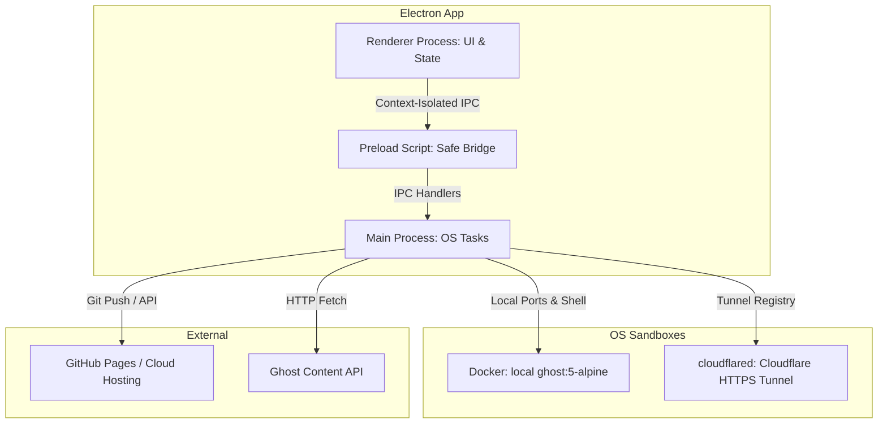

# StaticGhost - Technical Specifications Document

This document outlines the system architecture, data models, APIs, integration rules, and operational requirements for the StaticGhost Desktop Application Suite.

---

## 1. System Architecture

StaticGhost is built on Electron's multi-process model to separate the user interface from low-level operating system tasks.



### 1.1 Process Architecture
* **Renderer Process (`src/renderer.js` & `src/index.html`)**: Orchestrates the dashboard interface. It manages state transitions, user input forms, profile toggling, and dialog animations.
* **Preload Script (`preload.js`)**: Serves as a secure boundary. It exposes isolated IPC channels using Electron's `contextBridge` to prevent untrusted frontend code from accessing Node APIs directly.
* **Main Process (`main.js`)**: Operates as the application's backend controller. It runs low-level Node APIs to control Docker processes, call keychains, write static HTML files, and run Git shell pipelines.

### 1.2 3-Tier Ecosystem Position
StaticGhost operates as the **bottom-of-funnel conversion product** inside the Swapp Technologies content ecosystem. Its role within the broader distribution funnel is:

| Tier | Channel | Purpose |
| :--- | :--- | :--- |
| **Tier 1 — Top of Funnel** | Reels / X (Twitter) short-form | Awareness & trust seeds |
| **Tier 2 — Middle of Funnel** | YouTube tutorials & StaticGhost blog | Deep trust accumulation (20–30 min depth) |
| **Tier 3 — Bottom of Funnel** | StaticGhost Community + Pro + Enterprise | Automated off-platform SaaS conversion |

See [`docs/architecture/12_SECTION_TECHNICAL_SPEC.md`](docs/architecture/12_SECTION_TECHNICAL_SPEC.md) for public system specifications and architecture diagrams.

---

## 2. Database Schema

StaticGhost uses two primary database strategies: a local profile store for application settings, and a sandboxed SQLite store for the content management engine.

### 2.1 Local Profile Database Schema (`project-profiles.json`)
Located in `app.getPath('userData')`, this is a flat JSON file storing configured blog profiles:

```json
{
  "profiles": [
    {
      "id": "string (UUID v4)",
      "name": "string (Profile Display Name)",
      "ghostUrl": "string (http://localhost:port)",
      "ghostApiKey": "string (Encrypted via safeStorage)",
      "customLayoutHtml": "string (Default layout code)",
      "customIndexLayoutHtml": "string (Index layout code)",
      "customPostLayoutHtml": "string (Post layout code)",
      "postTemplates": [
        {
          "key": "string (Matching Tag/Slug)",
          "name": "string (Friendly Name)",
          "html": "string (Custom override HTML layout)"
        }
      ],
      "outputDir": "string (Absolute path for static export)",
      "affiliateDomains": ["string"],
      "enableAffiliateAutoTag": "boolean",
      "enableFormRedirect": "boolean",
      "formRedirectUrl": "string",
      "giscusRepo": "string"
    }
  ]
}
```

### 2.2 Local Ghost Content Database (Docker SQLite3)
Stored inside the persistent Docker volume mount `/var/lib/ghost/content/data/ghost.db` utilizing Ghost's standard schema.

---

## 3. API Specifications

### 3.1 Inter-Process Communication (IPC) Channels

| Channel | Method | Payload | Returns | Description |
| :--- | :--- | :--- | :--- | :--- |
| `load-profiles` | `invoke` | None | `{ success, profiles }` | Decrypts and returns all project profiles. |
| `save-profiles` | `invoke` | `profiles` | `{ success }` | Encrypts secrets and saves profiles to disk. |
| `start-ghost-docker` | `invoke` | `{ port, volumePath }` | `{ success, message }` | Spin up local Docker instance. |
| `stop-ghost-docker` | `invoke` | None | `{ success, message }` | Terminate active local container. |
| `test-ghost-connection` | `invoke` | `{ url, apiKey }` | `{ success, message }` | Ping Ghost Content API. |
| `export-static-site` | `invoke` | `{ config }` | `{ success, message }` | Compiles site pages to static build. |
| `deploy-github` | `invoke` | `{ options }` | `{ success, message }` | Runs deployment script. |

---

## 4. Integration Requirements

* **Docker Desktop**: The host system must have the Docker daemon running to compile and manage local Ghost instances.
* **Cloudflare Tunnel (`cloudflared`)**: Bundled or linked local CLI binary required to expose local ports via tunnel logic.
* **Giscus Engine**: Requires a public GitHub repository with Discussions enabled to store client comments.
* **Keychain Services**: Operates using native operating system keychains:
  * Windows: DPAPI (Data Protection API)
  * macOS: Apple Keychain Services
  * Linux: Libsecret / Secret Service API

---

## 5. Data Synchronization

* **Volumetric Persistence**: Docker mounts a local folder path (configured per project) directly to the container's interior:
  ```bash
  -v "C:\Users\username\.staticghost\volumes\my-blog\content:/var/lib/ghost/content"
  ```
  This preserves themes, data uploads, and settings across container lifetimes.
* **Exporter Pipeline**: When compilation runs, the system pulls live articles from the Content API and writes static files to `outputDir`.

---

## 6. Security & Compliance

### 6.1 Technical Security Controls
* **Credential Protection**: API keys and passwords are encrypted using Electron's `safeStorage.encryptString()`. Decryption keys are stored inside OS-managed keychains.
* **Context Isolation**: Direct node integration is disabled in UI viewframes (`nodeIntegration: false`, `contextIsolation: true`).
* **AES-256-GCM Content Protection**: For paid/private content, the post body is encrypted at build time with authenticated AES-256-GCM. The key is derived with PBKDF2-HMAC-SHA256 at 600,000 iterations over a random 16-byte salt, using a random 96-bit IV. Plaintext is stripped and never written to the build output. Visitors decrypt in-browser using the platform's native Web Cryptography API — no third-party script is loaded:
  ```javascript
  const key = await crypto.subtle.deriveKey(
    { name: 'PBKDF2', salt, iterations: 600000, hash: 'SHA-256' },
    baseKey, { name: 'AES-GCM', length: 256 }, false, ['decrypt']
  );
  // GCM verifies the auth tag, so an incorrect password fails here rather than
  // producing garbage plaintext.
  const plain = await crypto.subtle.decrypt({ name: 'AES-GCM', iv }, key, data);
  ```
  **Limitation:** because the ciphertext is published in a public file, it is subject to offline password attack. The iteration count raises that cost but does not eliminate it — post passwords should be strong.

### 6.2 Commercial Terms — Draft Notes (not in effect, pending counsel)
The public license is AGPL-3.0-only; its own warranty disclaimer and limitation of liability (§§15-16) govern Community Edition use. The draft terms below reflect intended terms for commercial licensing agreements:

1. **Limitation of Liability Clause**: Swapp Technologies LLC's maximum aggregate monetary liability to any user arising out of the use of StaticGhost is capped at the total amount paid by that user in the 12 months prior to the claim, or $100 USD for free Community Edition users, whichever is greater. StaticGhost is provided "as-is" with no warranty of merchantability or fitness for a particular purpose.

2. **Governing Law Clause**: Disputes arising under commercial agreements shall be governed by and construed in accordance with the laws of the **State of Maryland, United States of America**, without regard to its conflict of law principles. Any legal action shall be brought exclusively in the state or federal courts located in the State of Maryland.

3. **Data Deletion Policy**: The StaticGhost Community Edition does not transmit, store, or share user blog content, API keys, or personal data to Swapp Technologies LLC servers. All such data remains on the user's local machine inside Electron's `userData` directory and Docker volumes. API keys are encrypted at rest using the host OS keychain. Users may delete all application data at any time by uninstalling the application and deleting the `userData` directory. Pro-tier edge analytics, where enabled, will be governed by a separate privacy policy (internal draft in `private-docs/PRIVACY_POLICY.md`).

4. **Indemnification Clause**: The user agrees to indemnify, defend, and hold harmless Swapp Technologies LLC and its officers, directors, employees, and agents from and against any claims, damages, obligations, losses, liabilities, or expenses (including reasonable attorneys' fees) arising from: (a) the user's use of StaticGhost; (b) the user's violation of any term of this license; or (c) the user's violation of any third-party right, including any intellectual property, privacy, or data protection right.

---

## 7. Performance Requirements

* **Build Time**: Exports 100+ articles in less than 3 seconds.
* **Container Resource Ceiling**: Local containers run with limited memory limits (`--memory="512m"`) to prevent host hardware starvation.
* **Search Execution**: Client-side Pagefind search loads in less than 20ms, running entirely in-browser.

---

## 8. Monitoring & Logging

* System events and process logs (Docker launch stdout/stderr, compilation errors) are written directly to Electron's user-data log directory:
  * **Windows**: `%APPDATA%\staticghost\logs\main.log`
  * **macOS**: `~/Library/Logs/staticghost/main.log`

---

## 9. Testing Requirements

* **Automated Tests**: Governed by `test-suite.js`.
* **Execution Constraint**: Tests must run and pass cleanly (`npm test`) prior to compiling any production release distribution.
* **Unit Coverage**: Requires assertions for Ghost API fetches, AES password protections, redirect rewrites, Giscus inclusions, multi-template tag routing, and sequential photo replacements.

---

## 10. Deployment & CI/CD

Desktop installers are compiled and packaged using `electron-builder` under an NSIS wrapper:

```bash
# Production compile command
npm run dist
```
Builds are saved directly to `dist/StaticGhost Setup <version>.exe` for distribution.

---

## 11. Edge Cases & Error Handling

* **Ghost Offline Fallback**: If the local Ghost instance is offline during export, the main process catches connection errors and presents a user-facing alert without crashing.
* **Empty Image Placeholders**: If the layout template has more `<!-- GHOST_PAGE_PHOTO -->` tags than actual body photos in a post, the excess tags are automatically replaced with empty strings (`""`) to prevent layout breaks.
* **SSL Validation Bypass**: Bypasses local certificate validation errors during Electron bin package downloads using:
  ```powershell
  $env:NODE_TLS_REJECT_UNAUTHORIZED="0"
  ```

---

## 12. Future Considerations

* **Incremental Exports**: Transition from complete rebuilds to incremental compiles by comparing post timestamps. Critical for blogs scaling past 200 posts.
* **Auto-Schedule Exporter**: Add background scheduling timers to trigger static site exports on a set frequency automatically (Pro tier feature).
* **StaticGhost Pro / Cloud Tier**: A managed, subscription-based version of the export pipeline for users who want a hosted dashboard rather than a local desktop install. Serves as the primary Tier 3 (Bottom of Funnel) conversion product.
* **Content Audit Score**: A machine-readable `auditScore` field (0–100) computed per post at export time, evaluating quality signals including: reading time within the 7–12 minute optimal range, presence of at least one heading structure, affiliate link density, and image count.
* **Postiz Integration**: A direct API bridge to a self-hosted [Postiz](https://github.com/gitroomhq/postiz-app) instance to auto-schedule blog post promotions on social media after every successful export run.

---

## Appendix

### Glossary of Abbreviations

* **AES-256**: Advanced Encryption Standard with a 256-bit key. A secure symmetric key encryption algorithm.
* **AGPLv3**: GNU Affero General Public License v3. Requires derivative SaaS products to publish source code.
* **CTIA**: Cellular Telecommunications Industry Association. Sets data-sharing compliance standards.
* **DPAPI**: Data Protection API. A cryptographic API built into Microsoft Windows.
* **IPC**: Inter-Process Communication. Mechanisms allowing Electron Main and Renderer processes to share data.
* **NSIS**: Nullsoft Scriptable Install System. An open-source system to create Windows installers.
* **SemVer**: Semantic Versioning. A release naming convention (`MAJOR.MINOR.PATCH`).
* **SLA**: Service Level Agreement. A commitment between a service provider and a client.

### External Dependencies List

* **`cheerio`**: Server-side jQuery implementation used to parse post image elements.
* *(none)* — password-protected posts use Node's built-in `crypto` at build time and the browser's native WebCrypto API at read time. No third-party cryptography dependency is shipped.
* **`electron`**: Framework for building cross-platform desktop applications.
* **`electron-builder`**: Tool to package and distribute Electron apps.
* **`pagefind`**: Static search library compiled directly into site bundles.
* **`postiz`** *(future)*: Open-source self-hostable social media scheduler for post-export content drip campaigns. See [gitroomhq/postiz-app](https://github.com/gitroomhq/postiz-app).

### Related Documents

* [`docs/architecture/12_SECTION_TECHNICAL_SPEC.md`](docs/architecture/12_SECTION_TECHNICAL_SPEC.md) — Sanitized system architecture and data flow specifications.
* [`DEVELOPMENT.md`](DEVELOPMENT.md) — Local developer setup, SemVer release guide, and contribution workflow.
* [`LICENSE`](LICENSE) — GNU Affero General Public License v3 (AGPL-3.0-only).
* [`private-docs/PRIVACY_POLICY.md`](private-docs/PRIVACY_POLICY.md) *(internal draft)* — Privacy policy governing Pro-tier edge analytics (pending counsel review and Pro launch).
