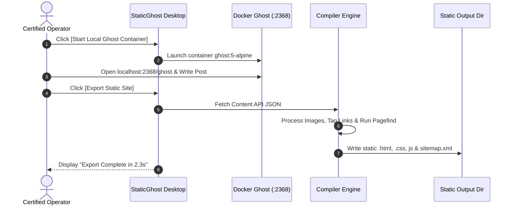

# 📋 SOP-02: Daily Operations & Static Export Workflow

> **SOP ID**: `SOP-STATICGHOST-02`  
> **Category**: Daily Operations & Content Compilation  
> **Target Role**: Certified Content Specialist / Technical Writer  

---

## 1. Objective
To execute daily blog writing workflows inside local Docker Ghost, configure post tags, and run 1-click static site compilation using StaticGhost Exporter.

## 2. Operational Workflow

## 3. Step-by-Step Operating Instructions

### Step 3.1: Launch Local Ghost Container
1. Open StaticGhost Desktop.
2. Select your target profile (e.g. `Personal Tech Blog`).
3. Click **"Start Local Ghost Container"**.
4. Wait 5 seconds until status badge changes to `🟢 Ghost Running on Port 2368`.

### Step 3.2: Write & Tag Posts in Ghost Editor
1. Open your browser to `http://localhost:2368/ghost`.
2. Log in and create a new post.
3. Apply standard post settings:
   - Add feature image.
   - Assign tags (e.g. `#gallery`, `#case-study`, or `news`).
   - For affiliate links, paste standard URLs (StaticGhost auto-appends `rel="sponsored"`).
4. Click **Publish** inside Ghost Editor.

### Step 3.3: Execute Static Export
1. Return to StaticGhost Desktop.
2. Verify **Output Directory** path (e.g. `C:/Users/user/Documents/GitHub/my-static-blog`).
3. Click **"Export Static Site"**.
4. Inspect export console output:
   - `✓ Pagefind search index compiled at /search/search-index.js`
   - `✓ RSS, Sitemap XML, and Robots.txt generated`
   - `✓ Export finished in 2.4 seconds`

---

## 4. Operational Guardrails
- **DO NOT** stop Docker container while Ghost Editor is saving drafts.
- **ALWAYS** run static export after adding or modifying published posts.
